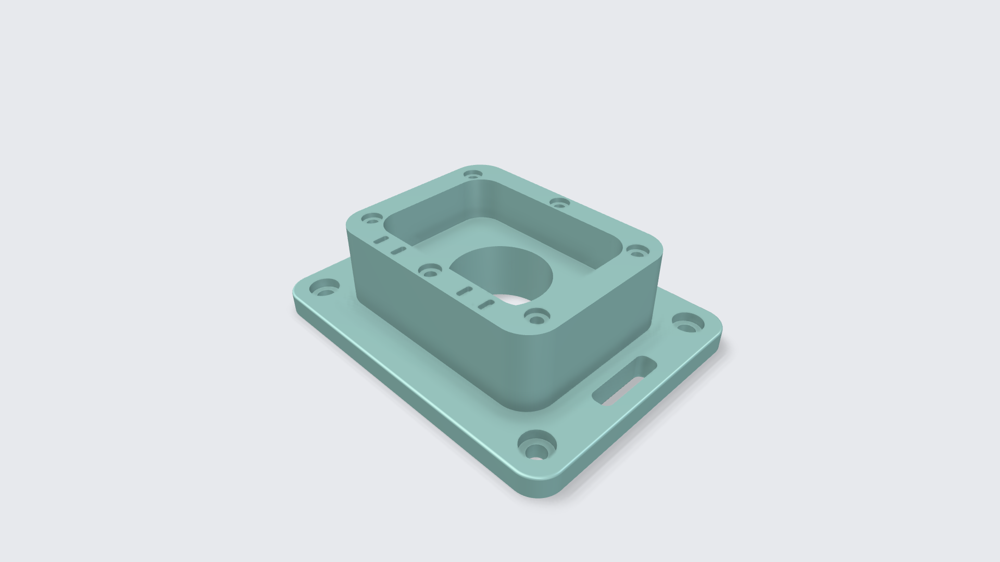

# PlainSolid

PlainSolid is an experimental, standard-library-only Go geometry kernel intended
to grow into an alternative to Open CASCADE Technology. **It is not yet an OCCT
replacement.** The full target and outstanding work are recorded in the
[specification](docs/SPECIFICATION.md) and [implementation plan](docs/IMPLEMENTATION_PLAN.md).
For an OCCT-to-Go API map, see the [migration guide](docs/MIGRATION.md).

Requires Go 1.23 or newer. No CGo, native libraries, or third-party Go modules.
The Go module path `plainsolid` is provisional. PlainSolid is available under
the [MIT License](LICENSE).



*ORBIT drive housing, rebuilt in PlainCAD with the PlainSolid WebAssembly kernel.*

## Current capabilities

| Package | Implemented domain |
| --- | --- |
| `geom`, `intersect` | Analytic geometry, exact-sign predicates, rational spline construction/editing/projection, certified spline–plane contours, spline-pair branch tubes, and certified spline distance and length bounds |
| `mesh`, `brep` | Indexed triangle meshes, planar shared-edge topology and holes, box and prism construction |
| `brep/parametric`, `brep/trimmed`, `brep/trimvalidate` | Analytic and spline patches, seams, poles, exact multispan degree-one/two trim topology, conforming tessellation and direct patch integration |
| `solid`, `csg`, `csg/poly`, `csg/offset`, `csg/fillet`, `csg/draft`, `csg/feature`, `section` | Box-cell, convex and nonconvex planar Booleans, sections, split, ancestry, planar offsets, draft and chamfer, blind pockets, protrusions and convex prism fillets |
| `csg/loft` | Exact corresponding planar rings, multi-station lofts, reentrant convex bands, separated miter cells, and original edge ancestry |
| `heal`, `heal/unify`, `collision`, `query` | Planar sewing and face unification, exact triangle contact, planar boundary distance and point location, mesh BVH |
| `exchange`, `exchange/step`, `exchange/iges` | OBJ/STL/PLY, embedded triangle glTF/GLB, native topology, planar/analytic STEP bodies, a STEP writer and reader for boundaries of planes and cylinders, rigid STEP assemblies, STEP/IGES spline geometry and IGES planar trims |
| `exchange/revolution` | Standalone versioned revolution persistence and strict IGES/STEP conversion |
| `document`, `scene` | Mixed asset assemblies, typed labels, feature regeneration, transactions, cameras, picking and projected hidden lines |

The curved kernel includes exact sphere, cylinder, cone and torus primitives,
sphere and parallel-cylinder Booleans, oblique cylindrical bores, spline graph
sections and shared-base graph Booleans, selected spline shell Booleans with
disjoint, nested or shared planar interfaces and verified transverse wires,
rounded boxes, polygonal
revolutions, circular sweeps, and elliptical lofts and extrusions.
`brep/boolean` is one general union, common and cut for solids bounded by
planes and cylinders, accepted on validation within tolerance; the PlainCAD
bridge asks it only where its own paths decline a request. `brep/blend`
chamfers straight edges between planar faces of such a result, convex or
concave, by cutting or uniting with the same Boolean. General curved Booleans, arbitrary
curved trim boundaries and broad CAD exchange remain open. See the
[status matrix](docs/STATUS.md) for the implemented domains and acceptance gaps.

About half of `brep/trimmed` is quarantined behind the `research` build tag:
the spline-graph, algebraic-shell and similar families that no other package
uses. Their exported names exist only when building with `-tags research`.

Selected exact APIs cover nonlinear edge contacts with a common affine
projection, wrapped spline plane sections, and a canonical rational toroid with
an embedded material boundary, STEP solid exchange, and exact point queries.
The certified mesher can bound spline and tube trim chords and full fundamental
patches. For affine and bilinear polynomial patches the bound covers both
directions of approximation through a common UV correspondence.
The kernel also certifies selected multi-span rational curved-trim meshes
and shared seams, exact circular cylinder rim blends and offsets, and
shared-base graph Booleans with straight, elliptical or partially
coincident contacts. The mixed wrapped STEP adapter preserves twelve
body families and named styles across rigid shared occurrences.
Selected spline edge-to-face contacts retain original owners and certified
parameter bounds. Native formats preserve nonbinary rational trim vertices
and exact algebraic seam subdivisions. STEP also exchanges a certified
two-support spline lens and selected connected nonplanar oval sheets.

## Example

Build and export a closed box mesh:

```go
package main

import (
    "log"
    "os"

    "plainsolid/exchange"
    "plainsolid/geom"
    "plainsolid/mesh"
)

func main() {
    m, err := mesh.Box(geom.Vec3{}, geom.Vec3{X: 10, Y: 20, Z: 30})
    if err != nil { log.Fatal(err) }
    if err = m.ValidateSolid(); err != nil { log.Fatal(err) }
    f, err := os.Create("box.stl")
    if err != nil { log.Fatal(err) }
    if err = exchange.WriteSTL(f, m); err != nil {
        _ = f.Close()
        log.Fatal(err)
    }
    if err = f.Close(); err != nil { log.Fatal(err) }
}
```

Inspect API contracts with `go doc plainsolid/geom`, `go doc plainsolid/mesh`,
`go doc plainsolid/solid`, and `go doc plainsolid/exchange`. The runnable
`go run ./examples/bracket -out bracket.stl` example performs box-union modeling,
a through-slot subtraction and STL export. Its end-to-end test validates topology
and independently checks the expected volume after reimport.

`go run ./examples/boredplate` builds an editable obliquely drilled plate with
stable face roles, writes its native document, and renders visible edges as SVG.

`go run ./examples/splineenvelope` builds a shared-base spline union and
exports both a native trimmed boundary and a conforming STL. Query
`capability.Current` for the programmatic support catalog.

`go run ./examples/ellipticallens` writes the exact two-face difference
of two spline graphs meeting along an ellipse and reports its volume.

`go run ./examples/tubelens` discovers and verifies a closed spline-pair
section, seals the original graph faces, and writes a native recipe with a
certified volume interval.

`go run ./examples/wrappedbore -out bearing` writes a rational spline
blind bore to `bearing.step` and `bearing.json`.

## Geometry contracts

Coordinates use float64 in a right-handed, unitless Cartesian system. Angles are
radians. Rational splines copy input data and allow concurrent evaluation.
Mesh slices are caller-owned and require synchronization when mutated.

`Mesh.Validate` checks finite coordinates, indices and triangle degeneracy.
`ValidateSolid` additionally checks closed, consistently oriented incidence and
connected vertex fans. It does **not** prove absence of geometric
self-intersections, outward orientation or correct cavity nesting. Signed volume
requires suitable closed, consistently oriented geometry for solid interpretation.
Numerical overflow and extreme coordinate scales need care; this is an
experimental kernel without a production-qualified numerical envelope.

## Exchange contracts

Readers accept `exchange.Limits`; zero fields select defaults of 64 MiB input,
3,000,000 vertices and 1,000,000 triangles. Input is buffered within the byte
limit. Set tighter limits for your application. Returned meshes may be open;
use `ValidateSolid` when a closed solid is required.

- `ReadOBJ` accepts triangular faces, negative indices, and texture/normal index
  references. Materials, groups, texture coordinates and normals are discarded.
  Polygon faces and freeform geometry are rejected.
- `ReadSTL` detects exact-length binary STL even when its header starts with
  `solid`, otherwise parses ASCII STL. It welds exact duplicate coordinates and
  discards supplied normals after validation.
- `WriteSTL` emits binary STL and rejects float32 overflow or collapsed
  triangles. Ordinary float32 rounding still occurs. `WriteASCIISTL` preserves
  float64 coordinate precision.
- `ReadJSON`/`WriteJSON` use native version 1 mesh documents. This is mesh
  persistence, not an exact CAD topology format.
- `ReadBRepJSON`/`WriteBRepJSON` preserve the vertex, shared-edge and oriented
  planar-face graph in version 1 native documents. `BRepLimits` separately bounds
  bytes, vertices, edges, faces and edge uses. The reader validates the graph
  through `brep.NewSolid`, including planar holes. Assemblies use document JSON.
- `ReadPLY` supports ASCII and both binary byte orders with x/y/z vertex
  properties and triangular index lists. Use `WritePLY` or `WriteBinaryPLY`.
  Extra properties/elements and polygon faces are outside the subset.
- `WriteGLTF` emits a self-contained glTF 2.0 scene with float32 positions,
  uint32 indices and an embedded base64 buffer. Float32 overflow and collapsed
  triangles are rejected. Materials, normals and CAD topology are omitted;
  `ReadGLTF` and `ReadGLB` accept a single embedded triangle scene; `WriteGLB`
  writes binary chunks. Coordinates are unchanged, so callers must
  choose the conversion to glTF's meter units and Y-up convention. See the
  [Khronos glTF specification](https://registry.khronos.org/glTF/specs/2.0/glTF-2.0.html).

See [STEP](exchange/step/README.md) and [IGES](exchange/iges/README.md) for
supported entity graphs, units, and interoperability checks. Native
`parametric.ReadJSON`/`WriteJSON` preserve supported analytic patch geometry and
shared topology. The trimmed format also stores certified implicit spline and
tube recipes and rechecks them when loading.

Writers propagate output errors. Callers own their streams and must close files.

## Testing

See [verification record](docs/VERIFICATION.md) for local checks, coverage and
explicit limits of the evidence.

A plain `go test` runs the default tier; use it while developing. It skips
every test that calls `slowtest.Skip`, and it does not compile the files
marked `//go:build research`, which are the parts of `brep/trimmed` that no
other package uses. `PLAINSOLID_SLOW=1` and `-tags research` add them back;
that complete suite takes hours and is what the Go qualification workflow and
the qualification launcher run. See
[the CI notes](tools/ci/README.md#test-tiers).

```sh
go test ./...                    # default tier, for every change
go vet ./...
export GOFLAGS=-tags=research PLAINSOLID_SLOW=1   # complete suite, before a release
go test ./...
go test -race ./...
bash tools/ci/trimmed-shard.sh 0 3 -timeout 45m # Repeat for indices 1 and 2
go test ./exchange -fuzz=FuzzReadSTL -fuzztime=10s
go test ./exchange -fuzz=FuzzReadOBJ -fuzztime=10s
go test ./exchange -fuzz=FuzzReadJSON -fuzztime=10s
go test ./exchange -fuzz=FuzzReadPLY -fuzztime=10s
go test ./exchange -fuzz=FuzzReadBRepJSON -fuzztime=10s
go test ./... -bench=. -benchmem
```

Go CI compiles all packages and runs focused smoke cases on pull requests to
`main` and pushes to `main`. The separate Go qualification workflow runs the
full Linux, macOS and Windows matrix, race checks and fuzz campaigns on demand.
See [CI commands](tools/ci/README.md). An [optional pinned OCCT oracle](tools/occtref/README.md)
checks selected modeling and exchange cases. The [pressure cap example](examples/pressurecap)
writes both an exact curved boundary and its conforming STL tessellation.

## Reference and provenance

[OCCT](https://github.com/Open-Cascade-SAS/OCCT) is the capability reference.
Current implementations are independently authored; OCCT source and fixtures
have not been copied into this repository. Future imported material needs its
own recorded provenance and applicable notices.

## Query and assembly contracts

`query.New` copies and validates a mesh, then builds its BVH. Queries are safe for
concurrent use. Point classification requires closed oriented shells, no
self-intersections and correctly oriented cavities. Ray intersections use
floating-point barycentric arithmetic; they are not exact predicates.

`document.State` uses stable caller-assigned string IDs and explicit
meters-per-unit. `document.New` copies state. Transactions own editable snapshots;
commits reject stale revisions. History limits count snapshots, not bytes.
`Flatten` expands instances, without Boolean union, with default limits of three
million vertices and one million triangles; `FlattenWithLimits` changes these.
Document persistence stores mesh, planar and analytic patch assets and supported
feature recipes. `FlattenGeometry` takes explicit deflection for curved assets.
